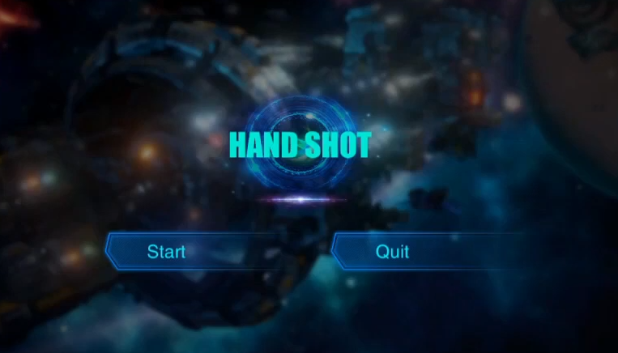
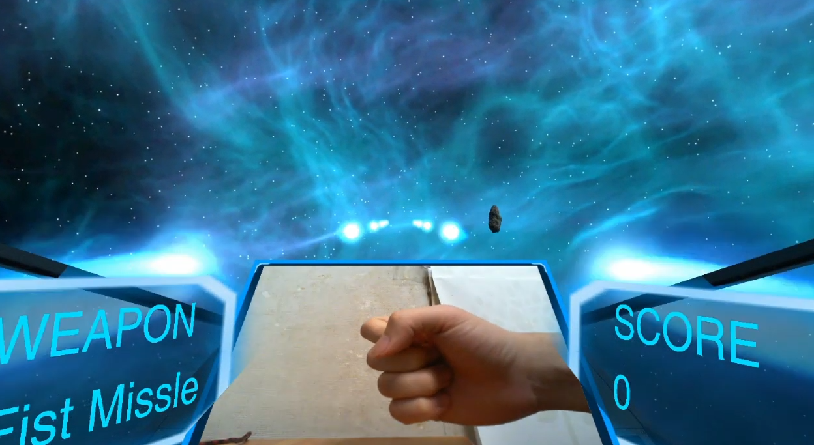
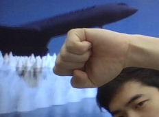
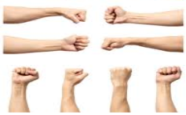
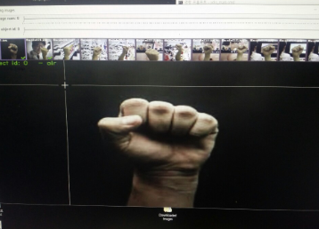
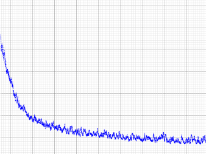
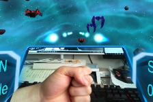
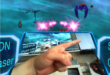
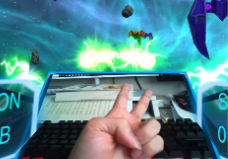

메디치이앤에스 교육 과정 수료 후 취업을 준비하며 진행한 프로젝트입니다. Darknet 프레임워크에서 YOLOv3 모델이 손 모양을 인식하도록 학습시킨 뒤, 이를 Unity에 적용해 간단한 게임을 개발했습니다.

기간: 2019.10 ~ 2019.11

사용 툴: Unity3D 2018, OpenCV, Darknet YOLOv3

## Hand Shot

{: .left w="355" h="265" }
{: .left w="355" h="265" }
        

[영상 링크](https://www.youtube.com/watch?v=Yzux3Kss9_8)

- 검지, 검지와 중지로 만든 V자, 주먹을 찍은 사진으로 YOLOv3 모델 학습
- 데이터셋을 구하기 위해 구글의 Image Downloader 활용
- 더 다양한 이미지를 수집하기 위해 OpenCV로 사진 촬영 프로그램 작성

### 1. 데이터셋 구하기

- 노트북 웹캠으로 일정 간격마다 사진을 찍는 프로그램을 작성하고, TV 다큐멘터리를 배경으로 손 사진을 직접 촬영 
  [소스 코드 링크](https://github.com/OverHeatHeart/PhotoTaker/blob/master/OpenCV_Practice/OpenCV_Practice/OpenCV_Practice.cpp) 
{: .left w="355" h="265" }
          

- 구글의 Image Downloader로 주먹, V, 검지 모양의 사진 대량으로 다운로드 
{: .left w="355" h="265" }
{: .left w="355" h="265" }
        
​     

### 2. 레이블링 및 훈련시키기

- 손에 해당하는 영역 레이블링 
{: .left w="355" h="265" }
          

- YOLOv3 모델 학습(Average Loss Chart) 
{: .left w="355" h="265" }
         
​     

### 3. 핸드 트래킹 및 총알 발사

- 주먹: 파란색 총알 발사, 파란색 적에 더 많은 피해 
{: .left w="355" h="265" }
          

- 검지: 빨간색 총알 발사, 빨간색 적에 더 많은 피해 
{: .left w="355" h="265" }
          

- V: 초록색 총알 발사, 레이스 적에게 더 많은 피해 
{: .left w="355" h="265" }
           
  [GestureCatcher.cs 소스 코드 링크](https://github.com/OverHeatHeart/Unity_Yolo/blob/master/Unity_Darknet_Game/Assets/%5B01%5D%20Scripts/GestureCatcher.cs)

