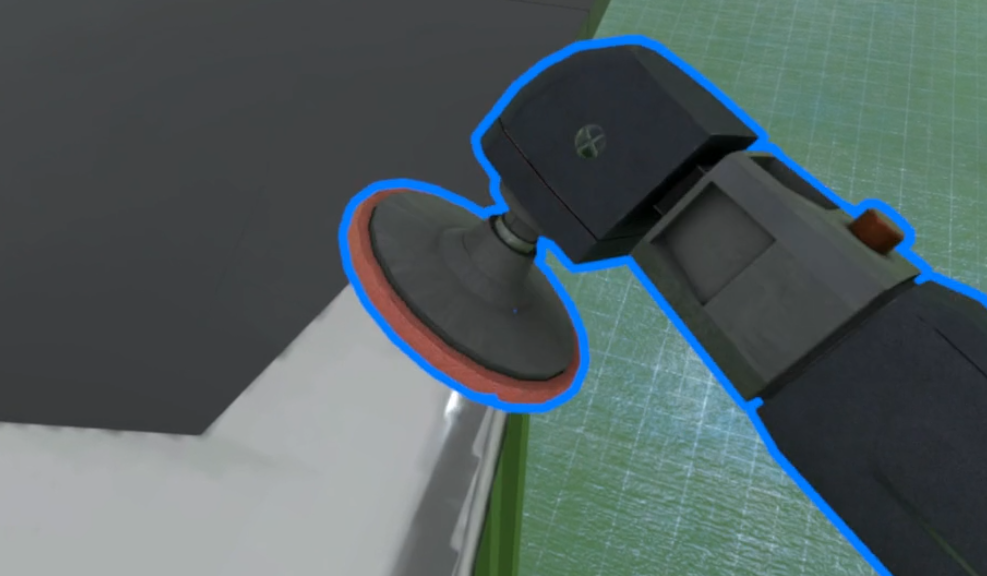
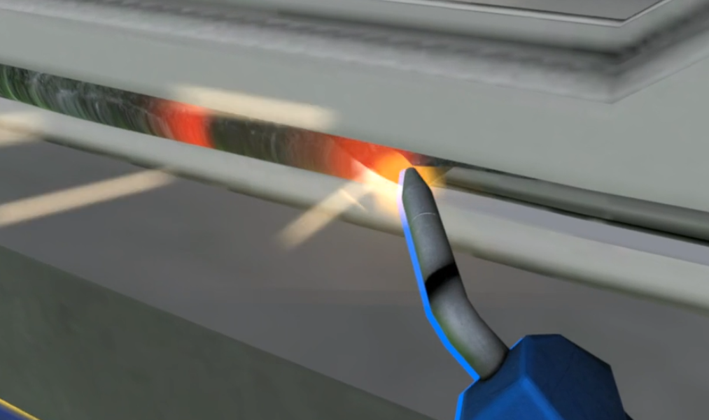

경기자동차과학고등학교의 자동차 정비 실습을 위한 차체 용접 콘텐츠를 개발했습니다.

## 차체 용접

{: .left w="355" h="265" }
{: .left w="355" h="265"}
        

- 기간: 2020.12 ~ 2021.02

- 사용 툴: Unity

### 1. 차체 용접 콘텐츠 개발

[영상 링크](https://vimeo.com/506034022/6b6225c5c1)

- 실습 시작 전 사전 지식 확인을 위한 퀴즈 머신 구현
- Render Texture를 이용한 Texture Paint, Vertex Position을 변경할 수 있는 셰이더 등을 이용한 용접 효과 연출
