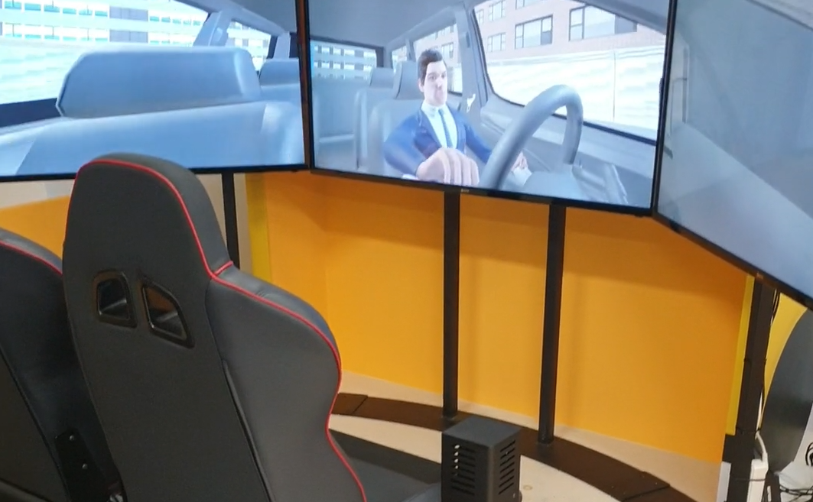
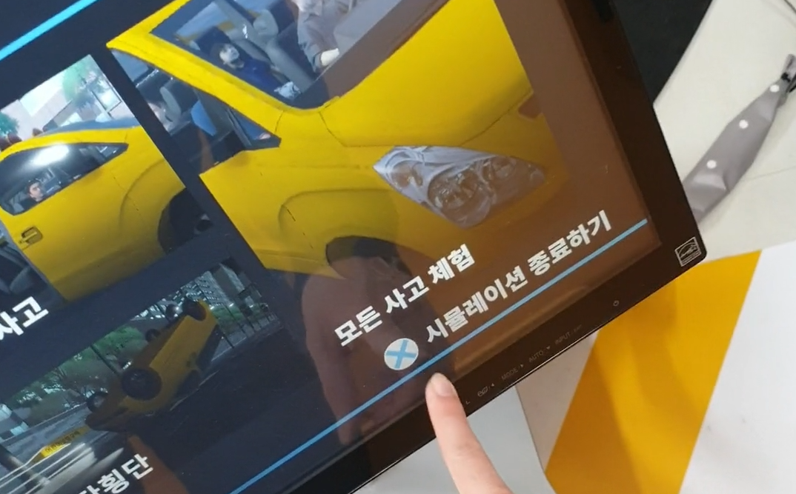
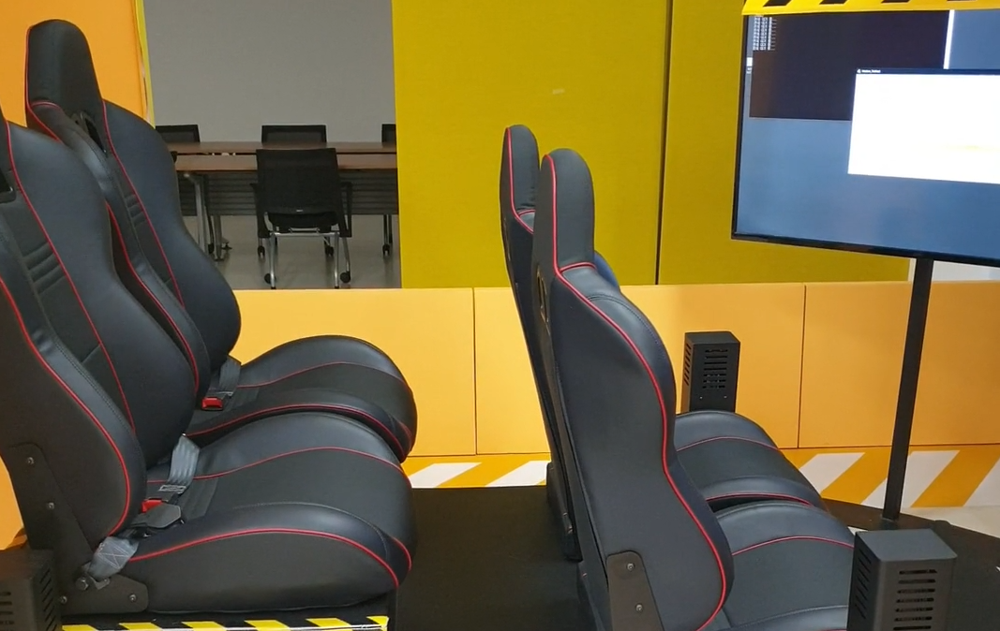
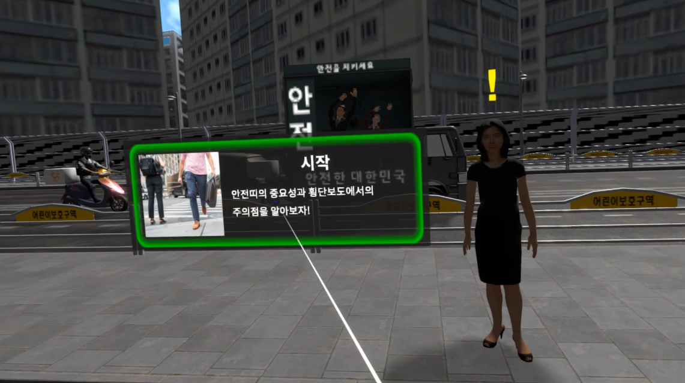
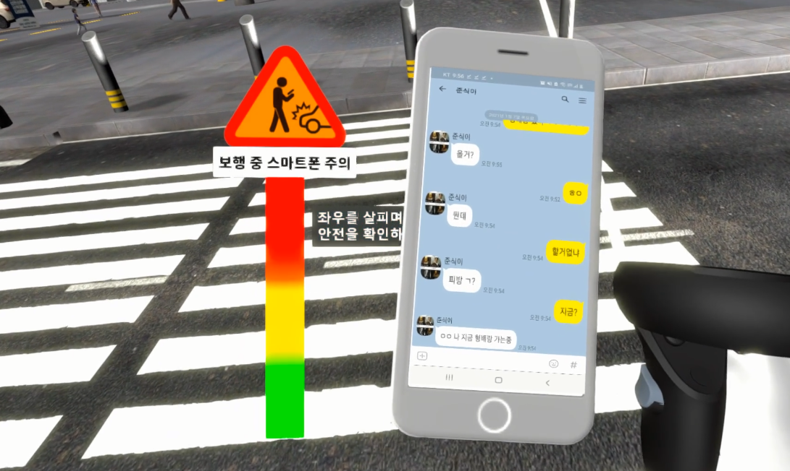

EBS의 2020년 안전·진로직업 VR/AR 실감형 콘텐츠 외주 제작 과제에서 모션 시트, VR, AR의 세 가지 콘텐츠 중 모션 시트와 VR 콘텐츠를 개발하고 유지 보수했습니다.

## 실감형 교통 안전 체험 콘텐츠

- 기간: 2020.04 ~ 2022.08

- 사용 툴: Unity3D 2019

### 1. 모션 시트 어트랙션 콘텐츠 제작

{: .left w="355" h="265"}
{: .left w="355" h="265"}
{: .left w="355" h="265"}
                 

[영상 링크](https://vimeo.com/739905448/a67feee359)

- 기존 개발된 콘텐츠 유지 보수 및 기능 추가
- Python으로 테스트 프로그램 - 테스트 - 콘텐츠 실행 자동화
- 모션 시트 콘텐츠 유지 보수 및 모션 시뮬레이터 연동 안정화
- 모션 시트 플러그인 업데이트에 따른 콘텐츠 추가 확장

  

### 2. VR 콘텐츠 제작

{: .left w="355" h="265"}
{: .left w="355" h="265"}
        

[영상 링크](https://vimeo.com/739905222/7d98d3c013)

- VR 콘텐츠 개발
- 레벨 디자인, 씬 배치
- 아바타 마스크를 적용한 입 모양 움직임, 사고 시 모션 적용
