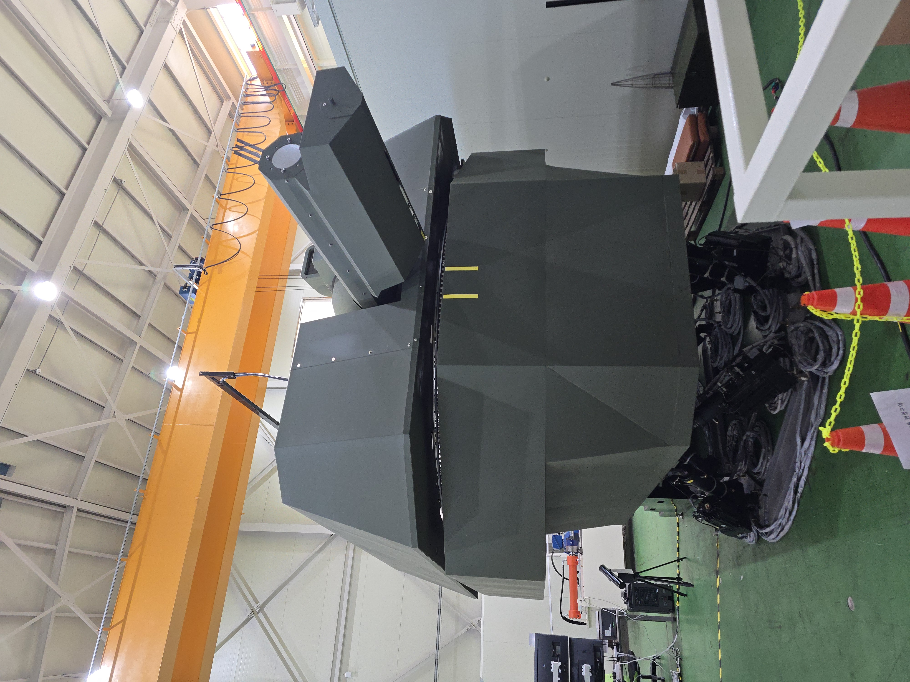
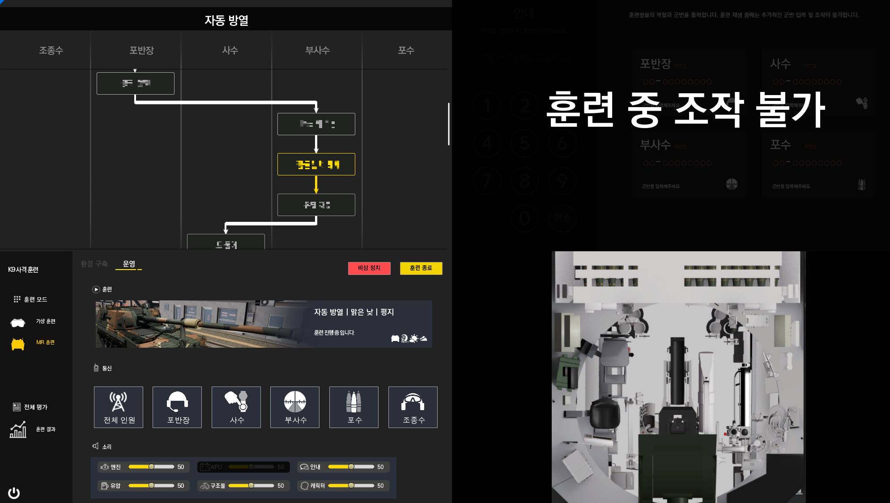
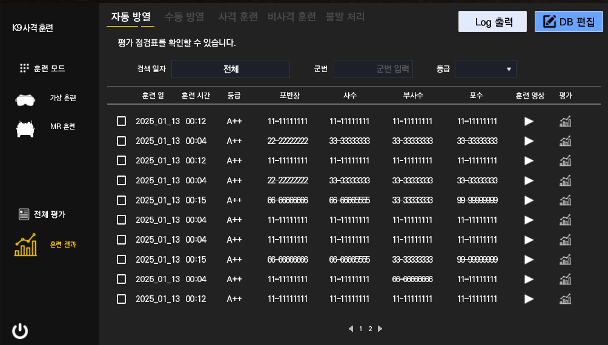
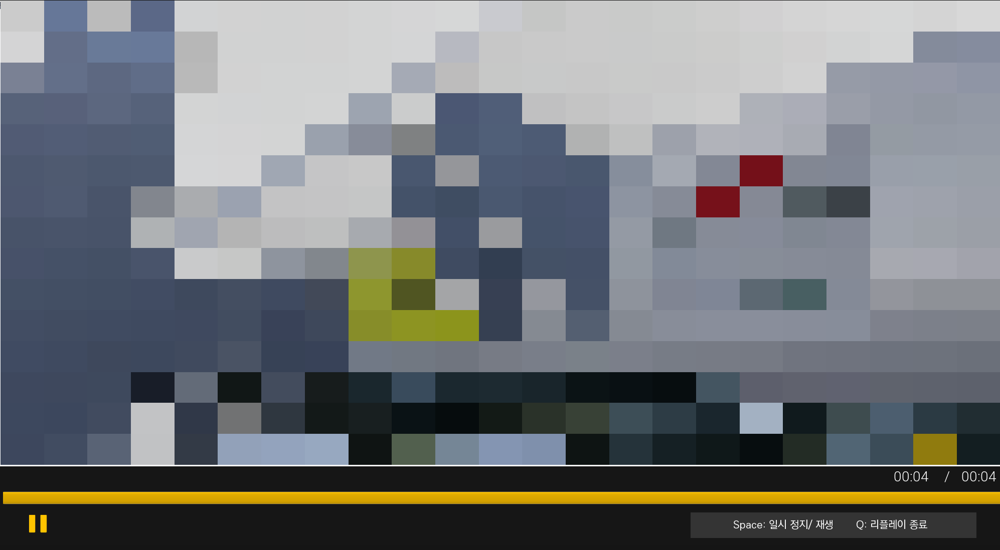
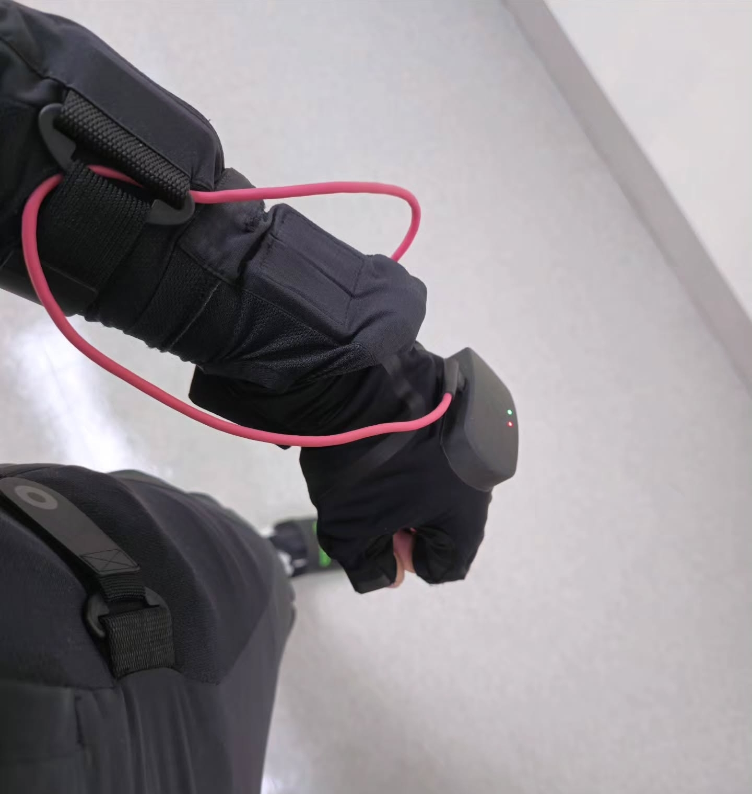
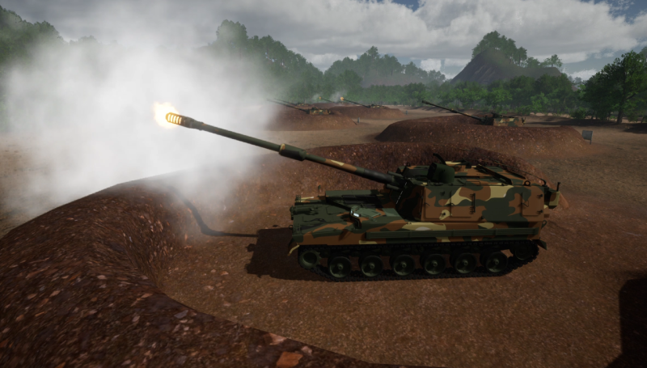

K9A1 자주포 포사격 훈련을 위해 VR, MR, 시뮬레이터의 세 가지 형태로 콘텐츠를 개발했습니다.
- VR: Meta Quest 3로 가상 캐릭터의 사격 훈련을 관전하는 콘텐츠
- MR: XREAL 글래스를 활용해 실제 환경에 가상 요소를 표시하는 포사격 훈련 콘텐츠
- 시뮬레이터: 시뮬레이터에 탑승하여 직접 사격 절차를 훈련하는 콘텐츠

VR 콘텐츠는 애니메이션을 보정하고 최적화했습니다. MR 콘텐츠는 프로젝트 설정, 콘텐츠 및 UI 추가, 패키징을 담당했습니다. 시뮬레이터에서는 관제 시스템 연동을 구현했습니다.

## K9A1 자주포 포사격 시뮬레이터

{: .normal w="400" h="250"}

- 기간: 2024.01~2025.04

- 사용 툴: Unreal Engine 5.3, Unity3D 2022, Rokoko

### 1. 멀티플레이 개발
- Dedicated Server 기반 4인 멀티플레이 개발
- 기존 개발된 조종수 시뮬레이터와 TCP 통신으로 연동하여 5인 훈련으로 확장

### 2. 하드웨어 연동
- 시뮬레이터 하드웨어와 MQTT 통신 연동

### 3. 관제 시스템 개발
- 관제 시스템(관리자) 개발 및 UI 작업

{: .normal w="800" h="500"}

### 4. 리플레이, 음성 채팅 플러그인 적용
- 음성 채팅 기능 추가
- 리플레이 기능 추가
- 훈련 평가 기능 추가

{: .left w="355" h="265" }
{: .right w="355" h="265"}
         

### 5. 애니메이션 및 이펙트 개발
- Rokoko 슈트 애니메이션 녹화
- 제작된 사격 애니메이션 적용 및 보정(Anim Blueprint, Control Rig 사용)
- 사격 효과 연기 제작(Niagara 사용)

{: .left w="355" h="265" }
{: .right w="355" h="265"}
              

### 6. VR 및 MR 기기 관련
- Meta Quest 3 기능 추가(Passthrough, Hand Tracking, Spatial Anchor)
- Meta Quest 3 퍼포먼스 프로파일링 및 최적화
- XREAL 글래스용 콘텐츠 패키징(Unity3D 엔진 사용)

### 7. 공개된 자료
[전북 테크노파크 홍보관](https://www.jbtp.or.kr/board/view.jbtp?menuCd=DOM_000000104004000000&boardId=BBS_0000014&paging=ok&startPage=1&dataSid=17638)
