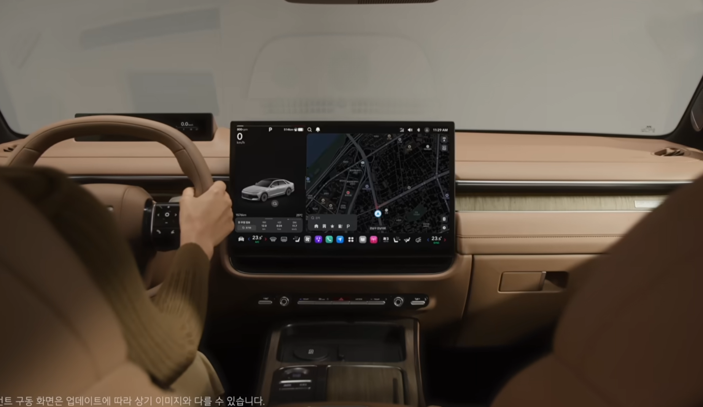
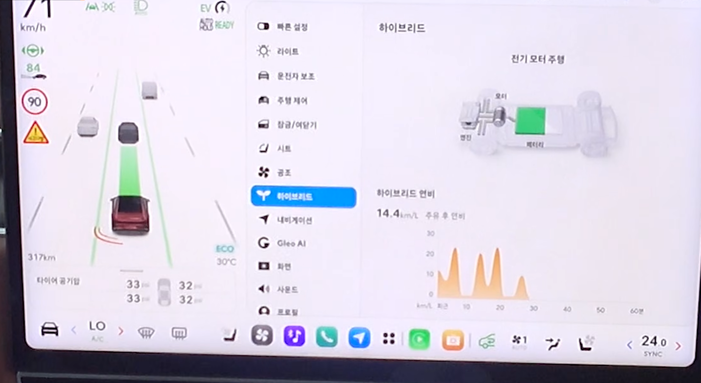
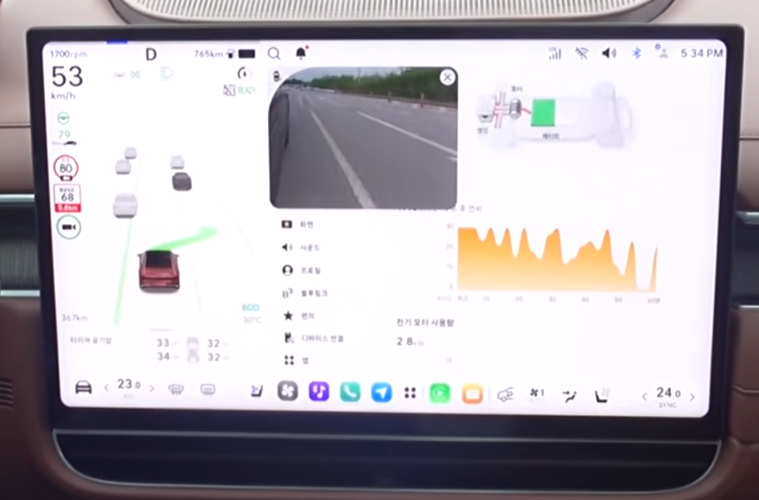
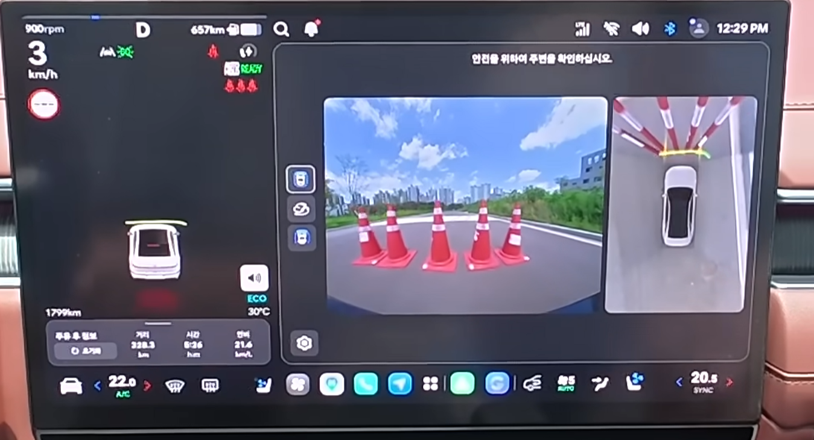
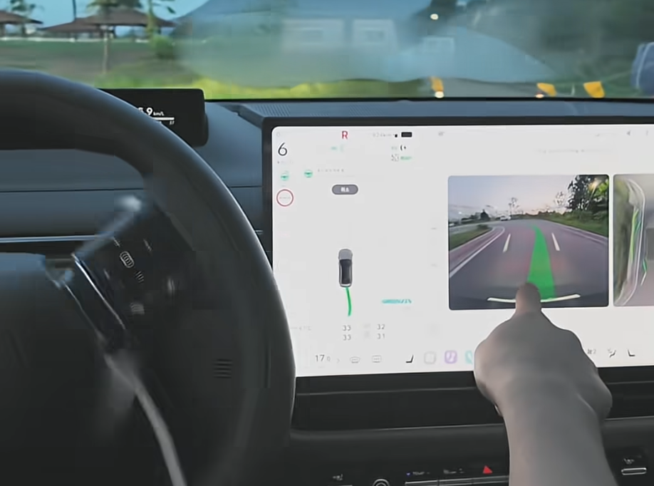
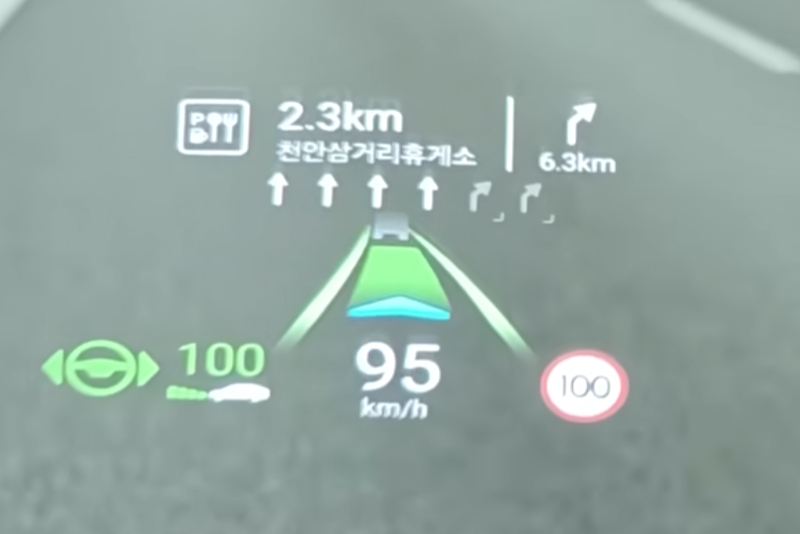

Unreal Engine 기반 차량용 클러스터 3D HMI 애플리케이션과 차량 에셋 자동 캡처 파이프라인 개발에 참여했습니다. HMI 영역에서는 ADAS 주행 정보와 HUD 기능 및 성능 개선, 신규 기능 개발(CCW, Smart Glass), 다차종 대응과 QNX 엔진 안정화를 담당했습니다. 또한 Dynamic Control 차량 에셋 캡처 자동화와 SADS·SUDS 공식 설계 문서 작성을 진행했습니다.

- 기간: 2025.07 ~ 2026.08
- 사용 툴: Unreal Engine 4.27, QNX, PlantUML

## 현대모비스 CID/HUD Connect UnrealHMI

### 1. ADAS 시각화 및 신규 기능·다차종 대응

차량의 주행·주차 보조 정보를 클러스터와 HUD에 표시하는 기능을 개발하고 유지보수했습니다.

{: .normal w="400" h="250"}

#### 1.1 차간거리 및 LCA(차선 변경 보조)

- 차간거리와 차선 변경 보조 표시를 Procedural Mesh 기반으로 재설계
- 클러스터와 HUD에서 서로 다른 표현 사양을 적용할 수 있도록 표시 구조 분리

{: .left w="355" h="265" }
{: .right w="355" h="265"}

          

이미지 출처: https://www.youtube.com/watch?v=DJTJM1x8O9Q

 

#### 1.2 PDW Contourline 표시 구조 개선

- PDW Contourline의 위치·높이·색상 보간과 애니메이션 개선
- 메모리 사용량을 줄이고 동작을 최적화

{: .normal w="400" h="265" }

이미지 출처: https://www.youtube.com/watch?v=IOMmSmwwYzA

#### 1.3 MRA(주차 경로) 기능 개선

- 주차 경로 좌표를 다운샘플링하고 Spline 구조를 수정하여 성능 개선
- 주차 경로 갱신 과정에서 발생하던 메모리 누수 수정

{: .normal w="400" h="265" }

이미지 출처: https://youtube.com/shorts/wqeaAMr_0h8?si=2k7J6wt8FK4r3knn

### 2. HUD 기능 및 성능 개선

클러스터 화면과 별도로 동작하는 HUD의 기능과 성능을 개선하고 표시 오류를 안정화했습니다.

- HUD 곡면에 맞춰 차선과 차간거리 UI가 표시되도록 워핑을 적용
- HUD 전용 차간거리 및 LCA 그라데이션 머티리얼 제작

{: .normal w="400" h="265" }

이미지 출처: https://www.youtube.com/watch?v=_rcTPsbIhSc

### 3. 성능 최적화 및 QNX 엔진 안정화

애플리케이션에서 발생한 성능·렌더링 문제의 원인을 프로젝트 코드뿐 아니라 QNX용 Unreal Engine 소스까지 추적해 수정했습니다.

- 빌트인 카메라와 GPU 간 경합을 유발하던 프레임 버퍼 용도 덮어쓰기 문제 수정
- QNX 환경의 Unreal Thread 우선순위 조정
- Scene Capture의 안티앨리어싱 처리 분리
- Shader 재컴파일 처리 보완

## 현대오토에버 차량 에셋 캡처 자동화

현대오토에버 납품용으로, 차량 애셋과 옵션별 결과물을 효율적으로 생성하기 위한 자동 캡처 파이프라인을 개발하고 고도화했습니다.

### 1. 캡처 자동화

- Movie Render Queue 기반 고해상도 캡처와 시퀀서 촬영 지원
- 레벨 정보를 자동으로 수집하고 캡처하는 Editor Utility Widget 추가
- 해상도, 시퀀스, 저장 경로 등 반복 작업 자동화

### 2. 다차종·다옵션 대응

- 도어, 휠, 컬러 등 차종별 옵션을 분리하여 캡처할 수 있도록 기능 확장
- 차종별 구조 차이를 흡수할 수 있도록 옵션 및 슬롯 구조 정리
- ActorLabel 기반 파일명 체계를 적용하여 결과물 식별성 개선

### 3. 파이프라인 안정화 및 구조 개선

- 캡처 후 렌더 타깃과 콘솔 변수를 복구하여 에디터 랙 방지
- 캡처 초기화, 시퀀서 생성, 예외 상황 처리 로직 보완
- 차종별로 분산된 옵션 구조를 공통 기반으로 통합하고 에디터 모듈 분리

## SADS·SUDS 설계 문서 작성

애플리케이션 개발과 병행하여 소프트웨어 아키텍처 설계서(SADS)와 소프트웨어 단위 설계서(SUDS)를 작성하고 유지보수했습니다.

### 1. 아키텍처 및 단위 설계

- 시스템 컨텍스트부터 패키지·클래스까지 이어지는 4단계 아키텍처 다이어그램 작성
- 초기화, 종료, 통신, 오류 처리와 주요 기능의 Dynamic View 작성
- 요구사항부터 아키텍처·단위 설계까지 이어지는 추적성 연계
- PlantUML 다이어그램 작성 및 관리

### 2. 문서 자동화 및 품질 관리

- 클래스 생명주기, 이벤트 처리, 상태 분기 등을 기준으로 메서드 다이어그램 선별 기준 수립
- 반복적인 문서 생성을 위한 LLM 보조 워크플로와 서식 검증 규칙 구축
- 아키텍처 설계서 개정 및 공식 리뷰 통과

## 주요 결과

- 앱 전반의 기능과 성능 개선
- 현대차 GN7FL(그랜저 페이스리프트)에 UnrealHMI 앱을 탑재하여 출시
- CN8 풀체인지 아반떼는 2026.08.05 출시되었으며, 후속 차종에도 탑재 예정
- 현대오토에버 Dynamic Control 이미지 납품 완료
